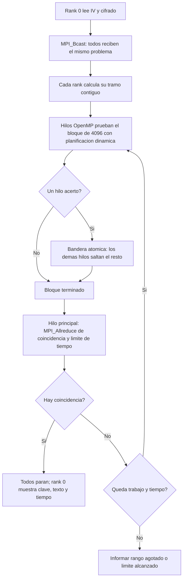

# Estrategia alternativa: híbrida MPI + OpenMP

Para empezar sin conocimientos previos, leer primero
[la explicación con ejemplos y la comparación con el Lab 3](explicacion-propuesta.md).

**Equipo:** Dulce Ambrosio (231143), Daniel Chet (231177) y Cristian Túnchez (231359).  
**Curso:** CC3069, Proyecto 02. **Estado:** estrategia elegida para el inciso 3, implementada como `-s hybrid -t <hilos>`.

## Estrategia de referencia (inciso 2)

El programa MPI del Lab 03 reparte bloques de 4096 candidatas cíclicamente.
En la ronda `r`, el proceso `p` prueba el bloque `r * P + p`.
Después de cada ronda, `MPI_Allreduce` comunica si se encontró una clave válida.
Las candidatas se prueban descifrando y buscando `es una prueba de`, sin recibir
la clave utilizada para cifrar.

Con `P = 4` y rango `[0, 2^56)`, las claves `2^54` y `2^54 + 1` están muy lejos
del comienzo del recorrido cíclico.

## Descripción de la estrategia

Dos niveles de paralelismo:

1. **MPI (memoria distribuida):** cada proceso recibe un tramo contiguo del rango.
2. **OpenMP (memoria compartida):** dentro de cada proceso, un equipo de hilos
   se reparte cada bloque de 4096 candidatas y las prueba al mismo tiempo.

### Distribución del trabajo

- El rank 0 lee el archivo cifrado (IV + texto cifrado) y lo envía a todos con `MPI_Bcast`.
- El rango se divide en `P` tramos contiguos; el cociente y el residuo se reparten
  entre los primeros procesos para no omitir ni duplicar candidatas.
  Cada proceso recorre su tramo en bloques de `-c` candidatas.
- Cada bloque se divide entre los hilos con `#pragma omp parallel for` y
  `schedule(dynamic, 64)`: un hilo que termina toma la siguiente porción libre.
- Cada hilo tiene su propio `EVP_CIPHER_CTX` y su propio buffer de texto plano.
- Si un hilo encuentra la clave, escribe una bandera compartida con
  `omp atomic` y los demás hilos del proceso saltan las candidatas restantes.
- Al final de cada ronda solo el hilo principal llama a `MPI_Allreduce`
  (MPI se inicia con `MPI_Init_thread` en modo `MPI_THREAD_FUNNELED`).
  Si algún proceso halló la clave, todos terminan.

Con 4 procesos y `2^56` candidatas, los tramos son:

| Proceso | Intervalo exclusivo en el extremo superior | Inicio |
|---|---|---|
| 0 | `[0, 2^54)` | `0` |
| 1 | `[2^54, 2 * 2^54)` | `18014398509481984` |
| 2 | `[2 * 2^54, 3 * 2^54)` | `36028797018963968` |
| 3 | `[3 * 2^54, 4 * 2^54)` | `54043195528445952` |

Los procesos sin trabajo siguen entrando a las colectivas hasta que termina la
búsqueda global. Si varios hilos o procesos hallan una coincidencia en una
ronda, se elige la menor de esa ronda.

## Justificación

a) **Clave al inicio de un tramo:** con 4 procesos, el proceso 1 empieza
   exactamente en `2^54`; las dos claves grandes se encuentran en la primera ronda.

b) **Menos procesos que coordinar:** con más hilos y menos procesos, cada
   `MPI_Allreduce` involucra menos participantes y la coordinación interna
   ocurre en memoria compartida.

c) **Balance de carga:** la planificación dinámica evita que un hilo espere
   mientras otro sigue trabajando.

d) **Parada temprana dentro del proceso:** la bandera atómica detiene a los
   hilos sin esperar el fin del bloque.

e) **Escalabilidad:** en un clúster, MPI reparte entre máquinas y OpenMP
   aprovecha los núcleos de cada máquina.

## Intentos previstos y límites

Con 4 procesos × 1 hilo y bloques de 4096:

| Clave, rango de 56 bits | Intentos cíclicos previstos | Intentos híbridos previstos |
|---|---:|---:|
| `123456` | `127553` | `504385` |
| `18014398509481984` | `18014398509494273` | `12289` |
| `18014398509481985` | `18014398509494274` | `12290` |

Son cálculos del recorrido, no tiempos medidos. Para `123456` la híbrida prueba
más claves porque los otros tres procesos trabajan lejos de ella.

**Los tramos dependen del número de procesos, no de hilos.** Con 2 × 2 el
segundo tramo empieza en `2^55` y con 1 × 4 el recorrido empieza en 0: en esas
configuraciones las claves grandes vuelven a quedar a `2^54` posiciones del
inicio. Con los mismos 4 núcleos, cambiar procesos por hilos no aumenta las
candidatas por segundo; lo que se compara es el costo de coordinación.

## Validación

Se ejecutan, con el mismo cifrado, 56 bits y bloques de 4096:

- base: `mpirun -np 4 ./build/search_mpi -s cyclic -t 1`;
- híbrida: `-s hybrid` con 4 × 1, 2 × 2 (`-np 2 -t 2`) y 1 × 4 (`-np 1 -t 4`).

`make benchmark` hace tres repeticiones de las búsquedas completables y limita
las inalcanzables con `--seconds`, extrapolando con su tasa medida. Los tiempos
excluyen cifrado, lectura, difusión inicial y arranque de `mpirun`.
Ver [mediciones y registros](measurements/RESULTADOS.md).

## Referencias técnicas

- [Open MPI: MPI_Allreduce](https://docs.open-mpi.org/en/main/man-openmpi/man3/MPI_Allreduce.3.html): combinación y difusión del resultado a todos los procesos.
- [Open MPI: MPI_Init_thread](https://docs.open-mpi.org/en/main/man-openmpi/man3/MPI_Init_thread.3.html): niveles de soporte de hilos.
- [OpenMP 5.2 API](https://www.openmp.org/spec-html/5.2/openmp.html): `parallel for`, `schedule(dynamic)` y `atomic`.
- [OpenSSL: EVP_EncryptInit](https://docs.openssl.org/3.0/man3/EVP_EncryptInit/): AES mediante EVP y relleno por bloques.
- [NIST: FIPS 197, AES](https://csrc.nist.gov/pubs/fips/197/final): definición del cifrado y claves AES-128.
